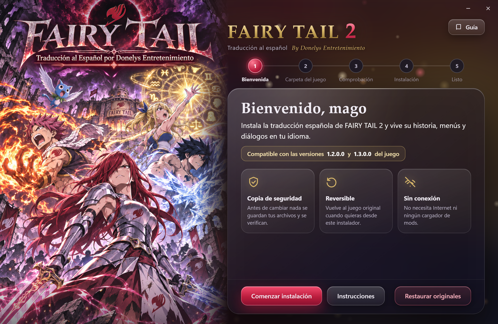

# FAIRY TAIL 2 — Traducción al español

Traducción **no oficial** de aficionados al español de España · **By Donelys Entretenimiento**



## Qué incluye

- Menús, textos y diálogos en español, con la terminología de Fairy Tail revisada.
- Fuente con `ñ`, `¿`, `¡`, tildes y comillas, y texturas traducidas (título, menús, efectos de combate).
- Instalador para Windows: un único `.exe`, sin necesidad de Internet ni de ningún cargador de mods.

## Cómo se instala

1. Descarga el instalador desde [Releases](../../releases).
2. Ábrelo y elige la carpeta del juego (la que contiene `FAIRY_TAIL_2.exe`).
3. Pulsa **Instalar traducción**. Antes de cambiar nada se guarda una copia de seguridad.

Para volver al juego original: abre el instalador y pulsa **Restaurar originales**.

Necesitas tu propia copia de FAIRY TAIL 2. El instalador no incluye ningún archivo del juego: solo textos y diferencias que se aplican sobre tus archivos.

## Versiones del juego

| Versión del juego | Estado |
|---|---|
| 1.2.0.0 | Probada: instala, cancela y restaura correctamente. |
| 1.3.0.0 (con los 12 DLC) | Probada: instala, cancela y restaura correctamente. Incluye la traducción de los textos que añade esta versión. |
| Posteriores a 1.3.0.0 | **No probadas.** Pueden dar problemas (textos nuevos sin traducir o archivos con otra estructura). |

Descarga siempre la última versión de [Releases](../../releases): la `v1.2.0-beta` es la primera con los textos de la 1.3.0.0. Las anteriores no instalan en la 1.3.0.0.

**Cómo se comporta con una versión no probada.** El instalador no comprueba sumas de verificación de tus archivos. Analiza su estructura: si es la esperada, instala; si no, lo dice y no modifica nada. Aun así, una versión posterior puede añadir textos que se verán en inglés, y no se garantiza que todo funcione en el juego. Antes de instalar guarda una copia de tus archivos y, si algo falla o cancelas, lo revierte todo. «Restaurar originales» devuelve tu juego tal como estaba.

Las pruebas se hicieron con réplicas de los archivos que toca el parche y con una instalación real en la 1.3.0.0. La comprobación dentro del juego es parcial: el apartado «Pendiente» de cada release dice qué falta por verificar.

## Para desarrolladores

```bash
dotnet build src/FT2ES.slnx -c Release
dotnet publish src/FT2ES.App -c Release -r win-x64 --self-contained
```

Las pruebas del motor (`src/FT2ES.EngineTests`) necesitan tus propios archivos originales del juego: define `FT2_TRABAJO` con la carpeta que contiene `backups_juego\`.

## Licencias

Código: [MIT](LICENSE). Componentes de terceros: [NOTICE.md](NOTICE.md). Agradecimientos: [AGRADECIMIENTOS.md](AGRADECIMIENTOS.md).

FAIRY TAIL es obra de Hiro Mashima. FAIRY TAIL 2 pertenece a KOEI TECMO GAMES y Gust. Este proyecto no está afiliado a ellos ni a Kodansha.
